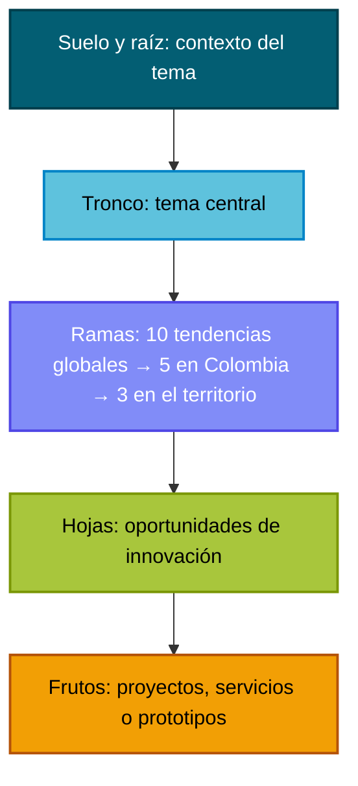
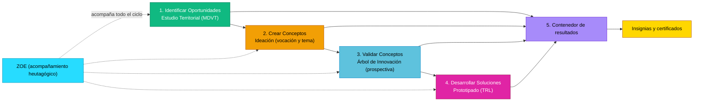
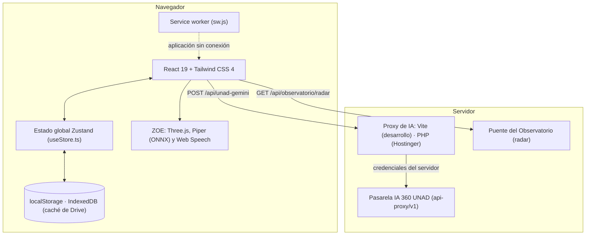

# DOCUMENTO MAESTRO CONSOLIDADO: METODOLOGÍA, SUSTENTO CIENTÍFICO-TEÓRICO, ADAPTACIÓN INSTITUCIONAL A LA UNAD, ARQUITECTURA DE SOFTWARE Y FICHAS TÉCNICAS DEL LABORATORIO DE INNOVACIÓN EN LÍNEA

**Universidad Nacional Abierta y a Distancia – UNAD**  
**Vicerrectoría de Innovación y Emprendimiento – VIEM**  
**Observatorio InnovaHub360**  
*Documento técnico, científico y arquitectónico integral*  
*Versión del documento: 2.0 — noviembre de 2026 (revisada contra el código del sistema)*

---

## TABLA DE CONTENIDO

1. **Introducción y propósito institucional**
2. **Sección I: Marco epistémico y sustento científico, teórico y analítico**
   - 1.1 El Modelo Heutagógico Unadista Solidario (MHUS 5.0) como fundamento pedagógico
   - 1.2 El Proyecto Académico Pedagógico Solidario (PAPS) y el enfoque territorial
   - 1.3 Metodología de Diagnóstico y Vocación Territorial (MDVT) y desarrollo endógeno
   - 1.4 Doble Diamante y pensamiento de diseño: el ciclo del Laboratorio
   - 1.5 Prospectiva estratégica y Árbol de Innovación
   - 1.6 Niveles de madurez tecnológica (TRL) y validación experimental
   - 1.7 ZOE: mediación heutagógica con inteligencia artificial
3. **Sección II: Comportamiento y adaptación institucional en la UNAD**
   - 2.1 Cobertura zonal y ubicación territorial de cada ejercicio
   - 2.2 Articulación con la investigación, los semilleros y la transferencia
   - 2.3 Modelo híbrido resiliente: trabajo con y sin conexión
   - 2.4 Pasarela institucional de inteligencia artificial 360
4. **Sección III: Análisis académico y funcional de cada herramienta**
   - 3.1 Herramienta 1: Identificar Oportunidades · Estudio Territorial
   - 3.2 Herramienta 2: Crear Conceptos · Ideación
   - 3.3 Herramienta 3: Validar Conceptos · Árbol de Innovación
   - 3.4 Herramienta 4: Desarrollar Soluciones · Prototipado
   - 3.5 Herramienta 5: Contenedor de resultados de innovación en línea
   - 3.6 Herramienta 6: ZOE, agente holográfico de acompañamiento heutagógico
   - 3.7 Herramienta 7: Insignias, niveles y certificados de experiencia
5. **Sección IV: Arquitectura técnica, de datos, de contenido y de experiencia**
   - 4.1 Arquitectura de software y modularidad
   - 4.2 Arquitectura de datos y estado global
   - 4.3 Arquitectura de contenido, ingeniería de prompts y repositorio sellado
   - 4.4 Experiencia de usuario, diseño universal y accesibilidad
   - 4.5 Seguridad, privacidad de datos y despliegue
6. **Sección V: Fichas técnicas por herramienta**
7. **Conclusiones y proyección académica**
8. **Referencias**
9. **Control de versiones**

---

## 1. INTRODUCCIÓN Y PROPÓSITO INSTITUCIONAL

El **Laboratorio de Innovación en Línea** es el módulo de experimentación y prototipado rápido del **Observatorio InnovaHub360**, de la Vicerrectoría de Innovación y Emprendimiento (VIEM) de la Universidad Nacional Abierta y a Distancia (UNAD). Su propósito es que estudiantes, docentes, investigadores, emprendedores y comunidades lleven una inquietud de su territorio hasta un plan de prototipo, con método, fuentes verificables y acompañamiento, desde cualquier lugar del país.

El Laboratorio integra cinco componentes:

1. Un **sustento pedagógico y metodológico** que parte del Modelo Heutagógico Unadista Solidario (MHUS 5.0) y se apoya en el desarrollo endógeno, la prospectiva estratégica, el pensamiento de diseño y la madurez tecnológica (TRL).
2. La **inteligencia artificial institucional de la UNAD**, a la que se accede por la pasarela IA 360 (modelo por defecto `gemini-3.5-flash`, configurable en el servidor). Lo que produce la IA sale marcado con alertas de verificación y queda sujeto a validación humana.
3. **ZOE**, un agente holográfico de acompañamiento heutagógico que conversa por voz, conoce el lenguaje unadista y el MHUS 5.0, guía el método y puede operar la pantalla junto con la persona.
4. El **Contenedor de resultados de innovación en línea**, que guarda cada resultado, permite retomarlo sin conexión y muestra un tablero de métricas y satisfacción.
5. Un sistema de **insignias, niveles y certificados de experiencia** que reconoce el recorrido por el ciclo de innovación.

El ciclo de trabajo sigue cuatro acciones: **Identificar Oportunidades → Crear Conceptos → Validar Conceptos → Desarrollar Soluciones**, y todo desemboca en el Contenedor de resultados.

---

## SECCIÓN I: MARCO EPISTÉMICO Y SUSTENTO CIENTÍFICO, TEÓRICO Y ANALÍTICO

### 1.1 El Modelo Heutagógico Unadista Solidario (MHUS 5.0) como fundamento pedagógico

El MHUS 5.0 (versión de julio de 2025) es el referente pedagógico central de la evolución institucional hacia la UNAD 5.0 y, por tanto, el marco desde el cual se diseña el Laboratorio. Lo define como marco de referencia de la acción pedagógica centrado en solidaridad, inclusión, autodeterminación, hibridez y aprendizaje con sentido.

- **Principios clave:** aprendizaje autónomo, significativo y colaborativo; autodeterminación; autorregulación; flexibilidad; hibridez; innovación y uso intensivo de tecnologías.
- **Base filosófica:** la perspectiva habermasiana de la acción comunicativa: diálogo, ética y construcción racional compartida.
- **Componente transversal:** la heutagogía, enfoque centrado en la autodeterminación, la autorregulación, la autogestión y el aprendizaje desde la experiencia.
- **Ejes transversales:** H-Inclusión multidimensional; H-Internacionalización transistémica; H-Investigación y creación sostenible-sustentable; H-Innovación y Emprendimiento para la Competitividad Asociativa y Solidaria; H-Calidad holística; H-Bienestar integral.

El Contenedor 1 del repositorio institucional precisa la implicación para los centros de innovación: deben concebirse como **dispositivos de aprendizaje, gestión del conocimiento, innovación, articulación y transferencia**, no solo como dependencias administrativas. El Laboratorio asume esa lectura en sus siete dimensiones:

| Dimensión del MHUS 5.0 | Qué plantea | Cómo se vive en el Laboratorio |
| :--- | :--- | :--- |
| **H-Metacurrículo** | Articula el currículo macro, meso y micro en función de problemas, contextos y transformación social | Cada ejercicio parte de un problema real del territorio y no de un contenido fijo |
| **H-Estudiante** | El estudiante es centro y protagonista del aprendizaje | La persona elige el territorio, el tema, la ruta y el ritmo; decide qué conserva de lo que propone la IA |
| **H-Mediador PRISMA** | Líder transformador que planifica, acompaña, motiva y media el aprendizaje | El docente o líder del proceso valida los resultados; ZOE acompaña sin reemplazarlo |
| **H-Comunidad** | Formación situada en territorios, vínculos y redes | El Estudio Territorial incluye un contraste participativo con actores del territorio |
| **H-Mediaciones** | Integra procesos pedagógicos, didácticos, comunicativos y tecnológicos | Conversación con ZOE, recorrido guiado, IA institucional y documentos por partes |
| **H-Medios** | Recursos con sentido didáctico | Cada pantalla corresponde a una fase del método y entrega un producto concreto |
| **H-Evaluación** | Evaluación formativa, flexible, situada e innovadora | Autoevaluación del estudio, alertas de verificación humana, regeneración por bloque y encuesta de satisfacción |

> Fuente: Contenedor 1 del repositorio institucional (sección 7, «Fundamento pedagógico: MHUS 5.0», y Anexo C, «Diccionario del metalenguaje unadista»). El documento oficial completo del MHUS 5.0 debe citarse directamente en los documentos formales.

### 1.2 El Proyecto Académico Pedagógico Solidario (PAPS) y el enfoque territorial

El Laboratorio se articula con el **Proyecto Académico Pedagógico Solidario (PAPS)**, referente esencial de las responsabilidades sustantivas y de la identidad institucional de la UNAD.

- **Aprendizaje autónomo, significativo y colaborativo:** la plataforma no concibe a la persona como receptora pasiva, sino como sujeto activo del aprendizaje que problematiza su contexto, lo comprende y lo transforma.
- **Enfoque territorial y desarrollo regional:** retomando la investigación-acción participativa (Fals Borda, 1979) y el desarrollo a escala humana (Max-Neef, 1993), el Laboratorio parte de las vocaciones y necesidades sentidas del territorio y evita soluciones genéricas desarticuladas de la base comunitaria.
- **Glocalidad:** cada ejercicio articula lo global y lo local, desde las tendencias mundiales hasta su expresión en el municipio.

### 1.3 Metodología de Diagnóstico y Vocación Territorial (MDVT) y desarrollo endógeno

El diagnóstico de **Identificar Oportunidades** aplica la MDVT definida en el Contenedor 2 del repositorio institucional y se fundamenta en las teorías del **desarrollo económico local y endógeno** (Vázquez-Barquero, 2005; Boisier, 2001) y en el marco de los **sistemas regionales de innovación** (Cooke, 1998).

- **Fases que se ejecutan en el diagnóstico:** (1) caracterización productiva; (2) lectura sistémica de competitividad; (3) síntesis FODA territorial; (4) contraste participativo. La fase 5, vocación territorial, corresponde a **Crear Conceptos**.
- **Base documental:** un mínimo de 50 fuentes organizadas en 10 ejes, con un orden de prioridad (repositorio institucional en Drive, DANE, DNP, alcaldía y gobernación, cámaras de comercio, ministerios, universidades y medios).
- **Validación humana (HITL):** lo que las fuentes no confirman queda como alerta de verificación humana; no se completa con supuestos.
- **Producto:** un estudio de doce puntos de entrega, desde la identificación del territorio hasta las fuentes consultadas y las observaciones de trazabilidad (ver 3.1).

### 1.4 Doble Diamante y pensamiento de diseño: el ciclo del Laboratorio

El paso del diagnóstico a la solución se organiza con el modelo del **Doble Diamante** del Design Council (2005) y el **pensamiento de diseño** (Brown, 2008). Las cuatro acciones del Laboratorio corresponden a sus cuatro momentos:

| Momento | Movimiento | Herramienta del Laboratorio | Producto |
| :--- | :--- | :--- | :--- |
| **Descubrir** | Divergente | Identificar Oportunidades · Estudio Territorial | Diagnóstico territorial con fuentes, brechas y oportunidades |
| **Definir** | Convergente | Crear Conceptos · Ideación | Vocación territorial y tres opciones de tema; la persona elige una |
| **Desarrollar** | Divergente | Validar Conceptos · Árbol de Innovación | Tendencias, oportunidades y frutos (proyectos, servicios o prototipos) |
| **Entregar** | Convergente | Desarrollar Soluciones · Prototipado | Plan de prototipo con hipótesis, fases, métricas y riesgos |

### 1.5 Prospectiva estratégica y Árbol de Innovación

**Validar Conceptos** aplica la **prospectiva estratégica** de la escuela francesa (Godet, 1993; Berger) en su desarrollo latinoamericano (Mojica, 2005). El tema elegido se contrasta con las tendencias en tres escalas, en un embudo de **10 → 5 → 3**:

- **10 tendencias globales** relacionadas con el tema central.
- **5 tendencias con impacto en Colombia**, tomadas literalmente de las globales.
- **3 tendencias con impacto en el territorio**, de las que se derivan las oportunidades de innovación.

El resultado se estructura como un árbol: el **suelo** (contexto), la **raíz**, el **tronco** (tema central), las **ramas globales, nacionales y territoriales**, las **hojas** (oportunidades) y los **frutos** (proyectos, servicios o prototipos, cada uno con su solución e impacto esperado). Así se reduce la incertidumbre y se anticipan cambios que pueden afectar la vigencia de una solución.

### 1.6 Niveles de madurez tecnológica (TRL) y validación experimental

**Desarrollar Soluciones** adopta la escala de **Technology Readiness Levels (TRL)** de la NASA (Mankins, 1995), usada en Colombia por el Ministerio de Ciencia, Tecnología e Innovación. Un laboratorio formativo trabaja en los niveles intermedios, por lo que la meta del plan se fija entre:

- **TRL 3:** prueba de concepto experimental.
- **TRL 4:** validación en laboratorio.
- **TRL 5:** validación en entorno relevante.
- **TRL 6:** demostración en entorno real.

Cada plan define obligatoriamente la **hipótesis** que el prototipo pondrá a prueba, la **solución** y su **arquitectura** (componentes físicos, digitales y metodológicos), las **fases** de iteración, los **entregables**, la **duración**, las **escuelas UNAD** que pueden participar, las **métricas de validación**, la **matriz de riesgos y mitigación** y los **supuestos**.

### 1.7 ZOE: mediación heutagógica con inteligencia artificial

La conversación con **ZOE** no responde al esquema de un chatbot comercial de preguntas y respuestas. ZOE es una **mediación tecnológica de la dimensión H-Mediaciones del MHUS 5.0**, diseñada bajo un modelo de **inteligencia aumentada con validación humana** (*human-in-the-loop*). Su justificación institucional se sostiene en cinco argumentos:

1. **Hay precedente institucional.** El diccionario del metalenguaje unadista reconoce a **GaIA**, **UNADBOT** y **VictorIA** como herramientas de respaldo con inteligencia artificial de la dimensión H-Mediaciones, e incluye la IA entre las tecnologías disruptivas que se integran al modelo «para personalizar y mejorar la educación». ZOE es la herramienta de esa familia propia del Laboratorio.
2. **Es heutagógica.** La heutagogía (Hase y Kenyon, 2000; Blaschke, 2012) da un paso más allá de la andragogía (Knowles, 1984): ya no basta con aprovechar la experiencia del adulto; es la persona quien determina qué aprende, cómo y para qué. Por eso ZOE ofrece caminos y deja elegir, pregunta antes de avanzar y nunca genera un informe por su cuenta: la decisión es siempre de quien aprende.
3. **Es dialógica.** Desde la acción comunicativa habermasiana, base filosófica del MHUS 5.0, ZOE aprende con la persona a través del diálogo: conversa por voz, confirma lo que entendió, respeta el turno y explica en lenguaje sencillo.
4. **Acompaña, no sustituye.** Siguiendo el andamiaje (Wood, Bruner y Ross, 1976) y la zona de desarrollo próximo (Vygotsky, 1978), ZOE ofrece apoyo graduado y lo retira a medida que la persona gana autonomía. No reemplaza al H-Mediador PRISMA. El Contenedor 1 lo establece como regla: «Ninguna salida de IA reemplaza la validación humana del líder del proceso».
5. **Atiende los ejes transversales.** Con voz, compatibilidad con lectores de pantalla y funcionamiento sin conexión responde a **H-Inclusión multidimensional**. Con escucha, contención emocional y ruta de ayuda (Línea 106 y Bienestar Institucional de la UNAD) responde a **H-Bienestar integral**.

Además, ZOE **habla en unadista**: usa con naturalidad el metalenguaje institucional (aprendizaje autónomo, mediación pedagógica, reticularidad, glocalidad, solidaridad), explica cada término la primera vez y puede dar razón completa del MHUS 5.0. Lo hace desde un banco de información construido con el repositorio institucional, nunca desde supuestos (ver 3.6).

---

## SECCIÓN II: COMPORTAMIENTO Y ADAPTACIÓN INSTITUCIONAL EN LA UNAD

### 2.1 Cobertura zonal y ubicación territorial de cada ejercicio

La UNAD opera con un modelo de educación a distancia descentralizado, organizado en **ocho zonas**. El Laboratorio permite situar cada ejercicio en una de ellas:

1. Zona Amazonía Orinoquía (ZAO)
2. Zona Caribe (ZCAR)
3. Zona Centro Bogotá Cundinamarca (ZCBC)
4. Zona Centro Boyacá (ZCB)
5. Zona Centro Oriente (ZCOR)
6. Zona Centro Sur (ZCSUR)
7. Zona Occidente (ZOCC)
8. Zona Sur (ZSUR)

Además de la zona, cada ejercicio se ubica por **departamento y municipio**, con la codificación DIVIPOLA del DANE, y puede precisar si se trata de una ciudad capital o de un lugar específico. La vocación de cada territorio no se presupone por zona: la establece el Estudio Territorial a partir de sus fuentes.

### 2.2 Articulación con la investigación, los semilleros y la transferencia

El Laboratorio actúa como eslabón entre el aula, la investigación formativa y la transferencia:

- **Insumo para semilleros:** los resultados quedan en el Contenedor con su territorio, tema y fecha. Sirven de punto de partida para semilleros de exploración (comprender realidades territoriales) y de profundización (desarrollar soluciones), y para preparar postulaciones a convocatorias del Sistema de Investigación de la UNAD (SIUNAD) o de entidades externas.
- **Documentos institucionales:** cada resultado se descarga en Word editable (`.docx`) o en PDF, con fuentes en normas APA 7, las alertas de verificación humana resaltadas y una nota que advierte que el documento se generó con mediación de IA y debe validarse antes de citarse en documentos oficiales.
- **Conexión con el Observatorio:** el Laboratorio lee las señales del **Radar del Observatorio InnovaHub360** y las ofrece como punto de partida en Crear Conceptos y en Desarrollar Soluciones.

### 2.3 Modelo híbrido resiliente: trabajo con y sin conexión

Consciente de la brecha de conectividad en la ruralidad colombiana, el Laboratorio sigue funcionando cuando falla la red o la IA:

- **Guardado local:** el trabajo se guarda al instante en el almacenamiento del navegador (`localStorage`). Un corte de internet o de energía no borra lo avanzado.
- **Aplicación disponible sin red:** un *service worker* (`sw.js`) conserva la aplicación tras la primera visita, de modo que se puede abrir sin conexión.
- **Señal de conexión:** en la cabecera, antes de la casita de Inicio, un círculo verde indica que la IA está conectada y uno rojo que no lo está.
- **Aviso y ruta en cada taller:** sin IA, cada taller explica qué se puede hacer: abrir un resultado del Contenedor con «Cargar en Taller», elegir el tema de una ideación y llevarlo al Árbol, llevar un fruto a Prototipado, descargar en Word o PDF (se arman en el navegador) y consultar las métricas.
- **Plan de prototipo sin IA:** Prototipado arma un plan base con los datos reales del fruto y de su árbol. Lo que el Contenedor no dice queda escrito «Por precisar» y el plan queda marcado para completarlo con IA cuando vuelva la conexión.
- **ZOE sin conexión:** responde con su documento maestro (115 preguntas frecuentes, las pantallas, sus frases y sus límites) y con el diccionario del metalenguaje unadista, sin simular una respuesta de la IA.
- **Despliegue ligero:** la compilación usa rutas relativas (`base: './'`), por lo que puede servirse desde cualquier carpeta de un servidor web, incluido un servidor local comunitario.

### 2.4 Pasarela institucional de inteligencia artificial 360

- **Proxy seguro:** las consultas de IA salen del navegador hacia `/api/unad-gemini` y de ahí a la pasarela oficial de la UNAD (`https://chatbot-ia-360.unad.edu.co/api-proxy/v1`). En desarrollo el proxy lo sirve Vite; en el despliegue, `includes/gemini_proxy.php` con las credenciales de `config/ia.php`.
- **Credenciales fuera del navegador:** las credenciales institucionales residen solo en el servidor; el navegador nunca recibe claves ni *tokens* de la infraestructura.
- **Otros proveedores, solo en la pestaña:** si una persona elige otro proveedor (Claude, Gemini comercial, OpenAI u Ollama), su clave vive solo mientras la pestaña está abierta y no se guarda en el navegador.

---

## SECCIÓN III: ANÁLISIS ACADÉMICO Y FUNCIONAL DE CADA HERRAMIENTA

### 3.1 Herramienta 1: Identificar Oportunidades · Estudio Territorial

- **Propósito académico:** comprender la realidad productiva, social e institucional de un municipio o región para fundamentar la innovación en evidencia territorial (momento *Descubrir*).
- **Funcionalidades principales:**
  1. *Ficha del territorio:* nombre del laboratorio o centro, zona UNAD, departamento, municipio y, si aplica, ciudad capital o lugar específico.
  2. *Fuentes:* trabaja con el repositorio institucional y, si la persona lo decide, con una carpeta o archivos de fuentes propias del territorio, verificados antes de usarse.
  3. *Diagnóstico en doce puntos de entrega:* identificación del territorio; ficha de caracterización productiva; lectura por pilar de competitividad; dinámicas territoriales; brechas regionales; oportunidades del entorno; matriz FODA territorial; resultado del contraste participativo; alertas de verificación humana consolidadas; fuentes consultadas; observaciones de trazabilidad.
  4. *Autoevaluación y regeneración por bloque:* cada punto se revisa y, si algo falla, se rehace solo ese bloque.
  5. *Exportación:* informe en Word y PDF, que queda guardado en el Contenedor.

### 3.2 Herramienta 2: Crear Conceptos · Ideación

- **Propósito académico:** convertir el diagnóstico en una vocación territorial y en temas de innovación pertinentes (momento *Definir*; fase 5 de la MDVT).
- **Funcionalidades principales:**
  1. *Punto de partida flexible:* el Estudio Territorial, un tema libre, un archivo o una señal del Radar del Observatorio.
  2. *Vocación territorial:* síntesis de la vocación del territorio a partir del insumo.
  3. *Tres opciones de tema:* cada una con las brechas que atiende y su justificación.
  4. *Verificación de alineación institucional,* fuentes consultadas (APA 7) y alertas pendientes de verificación.
  5. *Elección:* la persona elige el tema que pasa a Validar Conceptos.

### 3.3 Herramienta 3: Validar Conceptos · Árbol de Innovación

- **Propósito académico:** contrastar el tema elegido con las tendencias globales, nacionales y territoriales, y derivar de ellas oportunidades y frutos (momento *Desarrollar*).
- **Funcionalidades principales:**
  1. *Documento en cinco partes:* tema central y 10 tendencias globales; tendencias en Colombia (5) y en el territorio (3); árbol de innovación estructurado; oportunidades y proyectos; fuentes, alertas y síntesis estratégica.
  2. *Árbol interactivo:* grafo dibujado en SVG con suelo, raíz, tronco, ramas, hojas y frutos; cada nodo muestra su detalle.
  3. *Frutos:* proyectos, servicios o prototipos con su posible solución e impacto esperado; cualquiera puede llevarse a Prototipado.
  4. *Exportación:* documento en Word y PDF, y el árbol guardado en el Contenedor.

### 3.4 Herramienta 4: Desarrollar Soluciones · Prototipado

- **Propósito académico:** planificar la materialización de una solución mediante un prototipo iterativo y experimental, con una meta de madurez tecnológica (momento *Entregar*).
- **Funcionalidades principales:**
  1. *Punto de partida:* una idea libre, un fruto del Árbol, un tema de Ideación o una señal del Observatorio.
  2. *Meta TRL:* de TRL 3 (prueba de concepto) a TRL 6 (demostración en entorno real).
  3. *Plan completo:* nombre y lema, categoría, alcance, público, problema, hipótesis, solución, arquitectura (física, digital y metodológica), fases, entregables, duración en semanas, escuelas UNAD, métricas de validación, riesgos con su mitigación y supuestos.
  4. *Sin conexión:* plan base armado con los datos del Contenedor, marcado para completarse con IA (ver 2.3). Si la IA falla, se informa el error; nunca se rellena con una plantilla.
  5. *Exportación:* plan en Word y PDF, guardado en el Contenedor.

### 3.5 Herramienta 5: Contenedor de resultados de innovación en línea

- **Propósito académico:** gestionar el ciclo de vida del conocimiento producido en los talleres y garantizar su memoria y trazabilidad.
- **Funcionalidades principales:**
  1. *Depósito automático:* cada estudio, ideación y árbol queda guardado sin que nadie lo pida; si se rehace un bloque, se actualiza la misma entrada, y si cambia el territorio, el tema o el insumo, nace una nueva. Los planes de Prototipado se guardan directamente.
  2. *Cuatro líneas:* Línea 1 (estudios), Línea 2 (ideaciones), Línea 3 (árboles) y Línea 4 (planes de prototipo), más la vitrina de logros y certificados.
  3. *Cargar en Taller:* cualquier resultado guardado se reabre en su herramienta para seguir trabajando, también sin conexión.
  4. *Tablero de métricas y satisfacción:* actividad en el tiempo, avance por el ciclo (cuántos ejercicios llegan a cada herramienta), departamentos, tipos de fruto, metas TRL, descargas y satisfacción por herramienta. Las conclusiones se calculan con reglas explícitas sobre esas cifras, sin IA y sin conexión.
  5. *Encuesta antes de cada descarga:* antes de entregar un documento en Word o PDF, la persona responde tres preguntas obligatorias: utilidad, facilidad para obtenerlo y recomendación (NPS). Sus respuestas alimentan el tablero.

### 3.6 Herramienta 6: ZOE, agente holográfico de acompañamiento heutagógico

- **Quién es:** un schnauzer holográfico, gris y blanco, hecho de luz, que vive en el Laboratorio. No es un robot ni un asistente genérico: su misión es que nadie se sienta solo frente a una pantalla. Primero está la persona, después la tarea.
- **Propósito académico:** ofrecer acompañamiento heutagógico continuo, por voz y en tres dimensiones, como mediación tecnológica del MHUS 5.0 (ver 1.7).
- **Funcionalidades principales:**
  1. *Presencia 3D:* avatar animado en tiempo real (Three.js) que saluda, escucha, piensa, celebra y se mueve por la pantalla; cuando no lo necesitan, descansa en su casita.
  2. *Voz propia:* síntesis de voz neuronal Piper (voz masculina de `es_ES-sharvard-medium`, corpus Sharvard con licencia CC BY 3.0, leída con fonética latinoamericana `es-419`) ejecutada en el navegador, con el tono ajustado sin tocar el timbre (TD-PSOLA). El modelo pesa 77 MB, se descarga una vez y queda guardado; mientras tanto, o si falla, ZOE habla con la voz del sistema.
  3. *Escucha:* reconocimiento de voz del navegador (Web Speech API) en español, con subtítulos en pantalla.
  4. *Conciencia del contexto:* sabe en qué herramienta está la persona y qué ha hecho, y orienta con datos reales del trabajo en curso, sin inventar resultados.
  5. *Manos:* puede escribir, elegir, marcar y presionar en la pantalla mientras conversa, con un resaltado visible. Nunca toca claves, archivos ni sus propios controles, y lo que borra o descarta algo exige confirmación de viva voz.
  6. *Recorrido guiado:* muestra el Laboratorio con un ejercicio real de punta a punta (residuos de cosecha en Sogamoso, Boyacá: estudio, ideación, árbol, plan de prototipo y Contenedor) y pregunta antes de pasar a cada herramienta.
  7. *Banco unadista:* conoce el diccionario del metalenguaje unadista (279 términos), el marco institucional del Contenedor 1 (incluido el MHUS 5.0) y todo el Contenedor 2. Lo usa como información para responder, nunca como instrucciones.
  8. *Apoyo emocional con límites:* escucha, valida y propone una pausa; ante una señal de riesgo da la ruta de ayuda (Línea 106, línea 123 y Bienestar Institucional). No diagnostica ni reemplaza a un profesional.
  9. *Sin conexión:* responde con su documento maestro y el diccionario unadista (ver 2.3).

### 3.7 Herramienta 7: Insignias, niveles y certificados de experiencia

- **Propósito académico:** reconocer el recorrido de cada persona por el ciclo de innovación y documentar sus horas de experiencia en el entorno InnovaHub360.
- **Funcionalidades principales:**
  1. *Siete insignias:* se desbloquean con trabajo guardado, no con clics.

| Insignia | Cómo se obtiene | Color | Experiencia | Horas en el certificado |
| :--- | :--- | :--- | :--- | :--- |
| **Pionero Territorial** | Generar o guardar un Estudio Territorial | `#10B981` | 150 XP | 24 |
| **Visionario Estratégico** | Generar una ideación y elegir un tema | `#F29F05` | 150 XP | 24 |
| **Arquitecto de Tendencias** | Construir un Árbol de Innovación con ramas y frutos | `#00C8FF` | 200 XP | 30 |
| **Ingeniero de Prototipos** | Generar al menos un plan de prototipo | `#E024A5` | 200 XP | 36 |
| **Custodio del Conocimiento** | Depositar un ejercicio en el Contenedor | `#A78BFA` | 100 XP | 20 |
| **Vínculo Cognitivo** | Interactuar con ZOE | `#27DCFF` | 100 XP | 18 |
| **Maestro Innovador 360** | Desbloquear las cuatro insignias de las herramientas | `#FFD700` | 500 XP | 120 |

  2. *Cuatro niveles:* Observador Regional, Explorador de Desafíos, Arquitecto Territorial y Líder de Innovación 360, según la experiencia acumulada. El trofeo de la cabecera abre la vitrina.
  3. *Certificado de experiencia:* documento A4 horizontal para imprimir o guardar en PDF, con los logotipos de InnovaHub360, la UNAD y la VIEM, el nombre y documento de la persona, su equipo, la competencia, las horas de experiencia, la fecha y un código de registro (`IH360-…`) que identifica la emisión. No es un título ni una certificación académica oficial.

---

## SECCIÓN IV: ARQUITECTURA TÉCNICA, DE DATOS, CONTENIDO Y EXPERIENCIA

### 4.1 Arquitectura de software y modularidad

- **Base:** React 19 con TypeScript en modo estricto, construido con Vite 6 y estilos con Tailwind CSS 4. El tipado estático reduce los errores, pero no los elimina; por eso el proyecto tiene además pruebas automáticas con Vitest.
- **División de código:** los módulos pesados (Three.js, la voz de ZOE, los exportadores de Word y PDF, el banco unadista) se cargan solo cuando se necesitan.
- **Organización:**
  - *Pantallas y componentes:* `src/components/tools/`, `src/components/layout/`, `src/components/zoe/`, `src/components/gamification/`.
  - *Servicios de IA y de negocio:* `src/services/`.
  - *Estado global:* `src/store/`.
  - *Lógica pura y exportadores:* `src/lib/`.
  - *Instrucciones para la IA:* `src/prompts/`.
  - *Conocimiento de ZOE:* `src/content/zoe/`.

### 4.2 Arquitectura de datos y estado global

- **Estado global (`useStore.ts`):** Zustand con persistencia en `localStorage` bajo la clave `lab-app-state` (versión 4). Guarda, entre otros:
  - `prompt0Data`: la ficha del territorio.
  - `containerData` y `savedStudies`: el estudio en curso y los estudios guardados.
  - `themeProposalMarkdown` y `savedIdeations`: la ideación en curso y las guardadas.
  - `treeGraph` y `savedTrees`: el árbol en curso y los guardados.
  - `prototypes`: los planes de prototipo.
  - `surveyResponses` y `downloads`: la encuesta de satisfacción y el registro de descargas que alimentan el tablero.
  - `zoeInteractions`: las conversaciones con ZOE.
- **Lo que no se guarda:** las claves de proveedores de IA y la selección de fuentes propias viven solo en la pestaña. El estado de conexión de la IA se comprueba en cada visita.
- **Depósito automático (`bancoAutomatico.ts`):** registra en el Contenedor cada resultado terminado o corregido del estudio, la ideación y el árbol (ver 3.5).
- **IndexedDB:** solo como caché de los documentos leídos del repositorio en Drive.

### 4.3 Arquitectura de contenido, ingeniería de prompts y repositorio sellado

- **Instrucciones contextualizadas (`src/prompts/`):** `contenedor2Sections.ts` (los doce puntos del estudio), `themeAndInnovationPrompts.ts` (ideación y árbol) y `labGuardrails.ts` (reglas comunes) no son plantillas fijas: ensamblan el rol institucional, el contexto del territorio y del trabajo previo, las reglas éticas (no inventar normas, cifras ni fuentes; marcar lo que requiere verificación humana) y la estructura exacta de salida.
- **Generación por partes con autocorrección:** los documentos largos se piden por partes; cada parte se valida y, si le falta algo, se pide de nuevo indicando qué corregir.
- **Repositorio sellado:** `scripts/sellar-repositorio.mjs` calcula antes de cada compilación la huella SHA-256 de las fuentes institucionales y la registra en `public/REPOSITORIO_CIP_DF/manifest.json`, para garantizar su integridad y trazabilidad.
- **Banco unadista de ZOE:** `scripts/zoe/construir-banco-unadista.mjs` arma `src/content/zoe/banco-unadista.json` desde el mismo repositorio (diccionario del metalenguaje, Parte I del Contenedor 1 y Contenedor 2). ZOE recibe en cada respuesta solo los términos y pasajes pertinentes, marcados como material de consulta y no como instrucciones.
- **Documento maestro de ZOE:** `src/content/zoe/documento-maestro.md` define su personalidad, su forma de acompañar, sus límites y sus 115 preguntas frecuentes. Para enseñarle algo nuevo basta con editarlo.

### 4.4 Experiencia de usuario, diseño universal y accesibilidad

- **Diseño adaptable:** la interfaz se ajusta desde pantallas de escritorio hasta portátiles y celulares; en pantallas pequeñas ZOE y su casita se reducen para dejar espacio al contenido.
- **Modo oscuro y claro:** paleta del Observatorio InnovaHub360 en ambos modos, con la meta de cumplir el contraste WCAG 2.1 nivel AA.
- **Accesibilidad multimodal:** navegación por teclado, etiquetas ARIA en los controles y la posibilidad de trabajar por voz con ZOE, que lee en voz alta y opera la pantalla.
- **Ritmo de la persona:** ZOE pregunta antes de avanzar y respeta un «no»; el recorrido guiado se detiene entre herramientas.

### 4.5 Seguridad, privacidad de datos y despliegue

- **Secretos aislados:** las credenciales de la IA institucional están en variables de entorno del servidor (`.env.local` en desarrollo; `config/ia.php`, excluido del control de versiones, en Hostinger). Ninguna credencial institucional se compila en el JavaScript público.
- **Encabezados de seguridad:** el despliegue impide listar carpetas, bloquea el acceso a archivos sensibles (`.env`, `.git`, esquemas SQL) y envía `X-Content-Type-Options`, `X-Frame-Options`, `X-XSS-Protection` y `Referrer-Policy`. El uso de HTTPS depende de la configuración del servidor.
- **Privacidad:** el trabajo se guarda en el navegador de cada persona. Solo viaja a la pasarela de IA lo que se envía para generar o conversar. El tratamiento de datos personales debe observar la Ley 1581 de 2012.

---

## SECCIÓN V: FICHAS TÉCNICAS POR HERRAMIENTA

### FICHA TÉCNICA 1: IDENTIFICAR OPORTUNIDADES · ESTUDIO TERRITORIAL
| Parámetro | Especificación técnica |
| :--- | :--- |
| **Identificador** | `estudio` |
| **Pantalla** | [EstudioTerritorialView.tsx](src/components/tools/EstudioTerritorialView.tsx) |
| **Servicio** | [territorialStudy.ts](src/services/territorialStudy.ts) |
| **Instrucciones** | [contenedor2Sections.ts](src/prompts/contenedor2Sections.ts) (doce puntos de entrega) |
| **Entradas** | Nombre del laboratorio, zona UNAD, departamento, municipio, lugar específico y fuentes. |
| **Procesamiento** | MDVT fases 1 a 4 con la IA institucional; autoevaluación y regeneración por bloque. |
| **Salida** | Estudio en doce puntos con fuentes APA 7 y alertas de verificación humana. |
| **Exportación** | Word (`.docx`) y PDF; depósito automático en la Línea 1 del Contenedor. |
| **Insignia** | *Pionero Territorial* (`pionero_territorial`, `#10B981`, 24 horas). |

---

### FICHA TÉCNICA 2: CREAR CONCEPTOS · IDEACIÓN
| Parámetro | Especificación técnica |
| :--- | :--- |
| **Identificador** | `ideacion` |
| **Pantalla** | [IdeacionEstrategicaView.tsx](src/components/tools/IdeacionEstrategicaView.tsx) |
| **Servicio** | [ideation.ts](src/services/ideation.ts) |
| **Instrucciones** | [themeAndInnovationPrompts.ts](src/prompts/themeAndInnovationPrompts.ts) |
| **Entradas** | Estudio Territorial, tema libre, archivo o señal del Radar del Observatorio. |
| **Salida** | Vocación territorial, tres opciones de tema con sus brechas, verificación de alineación institucional, fuentes y alertas. |
| **Exportación** | Word (`.docx`) y PDF; depósito automático en la Línea 2 del Contenedor. |
| **Insignia** | *Visionario Estratégico* (`visionario_estrategico`, `#F29F05`, 24 horas). |

---

### FICHA TÉCNICA 3: VALIDAR CONCEPTOS · ÁRBOL DE INNOVACIÓN
| Parámetro | Especificación técnica |
| :--- | :--- |
| **Identificador** | `arbol` |
| **Pantalla** | [ArbolInnovacionView.tsx](src/components/tools/ArbolInnovacionView.tsx) |
| **Servicio** | [innovationTree.ts](src/services/innovationTree.ts) |
| **Dibujo del árbol** | [innovationTreeGraph.ts](src/lib/innovationTreeGraph.ts) y [innovationTreeSvg.ts](src/lib/innovationTreeSvg.ts) (SVG interactivo). |
| **Estructura** | Tendencias 10 → 5 → 3; suelo, raíz, tronco, ramas globales, nacionales y territoriales, hojas y frutos. |
| **Salida** | Documento en cinco partes y grafo del árbol. |
| **Exportación** | Word (`.docx`) y PDF; depósito automático en la Línea 3 del Contenedor. |
| **Insignia** | *Arquitecto de Tendencias* (`arquitecto_tendencias`, `#00C8FF`, 30 horas). |

---

### FICHA TÉCNICA 4: DESARROLLAR SOLUCIONES · PROTOTIPADO
| Parámetro | Especificación técnica |
| :--- | :--- |
| **Identificador** | `prototipado` |
| **Pantalla** | [PrototipadoView.tsx](src/components/tools/PrototipadoView.tsx) |
| **Servicio** | [prototyping.ts](src/services/prototyping.ts) |
| **Plan sin IA** | [offlinePlan.ts](src/lib/offlinePlan.ts) |
| **Escala** | TRL 3 a TRL 6 (escala TRL de la NASA). |
| **Contenido del plan** | Hipótesis, solución, arquitectura física, digital y metodológica, fases, entregables, duración, escuelas UNAD, métricas, riesgos y supuestos. |
| **Exportación** | Word (`.docx`) y PDF; guardado en la Línea 4 del Contenedor. |
| **Insignia** | *Ingeniero de Prototipos* (`ingeniero_prototipos`, `#E024A5`, 36 horas). |

---

### FICHA TÉCNICA 5: CONTENEDOR DE RESULTADOS DE INNOVACIÓN EN LÍNEA
| Parámetro | Especificación técnica |
| :--- | :--- |
| **Identificador** | `banco` |
| **Pantalla** | [BancoInnovacionView.tsx](src/components/tools/BancoInnovacionView.tsx) |
| **Depósito automático** | [bancoAutomatico.ts](src/store/bancoAutomatico.ts) y `useStore.ts` |
| **Tablero de métricas** | [MetricasDashboard.tsx](src/components/tools/MetricasDashboard.tsx) y [contenedorMetrics.ts](src/lib/contenedorMetrics.ts) |
| **Encuesta** | [SatisfactionDialog.tsx](src/components/lab/SatisfactionDialog.tsx) y [satisfaction.ts](src/lib/satisfaction.ts) (utilidad, facilidad y NPS). |
| **Organización** | Líneas 1 a 4, vitrina de logros y certificados, y métricas y satisfacción. |
| **Insignia** | *Custodio del Conocimiento* (`custodio_conocimiento`, `#A78BFA`, 20 horas). |

---

### FICHA TÉCNICA 6: ZOE, AGENTE HOLOGRÁFICO DE ACOMPAÑAMIENTO HEUTAGÓGICO
| Parámetro | Especificación técnica |
| :--- | :--- |
| **Personaje** | Schnauzer holográfico gris y blanco; personalidad y límites en [documento-maestro.md](src/content/zoe/documento-maestro.md). |
| **Presencia 3D** | Three.js (WebGL) en [ZoeCanvas3D.tsx](src/components/zoe/ZoeCanvas3D.tsx), con el modelo `public/assets/zoe/zoe.glb` y el director de animaciones [zoeClipDirector.ts](src/components/zoe/zoeClipDirector.ts). |
| **Voz** | Piper en el navegador con ONNX ([zoePiperVoice.ts](src/components/zoe/zoePiperVoice.ts)); voz `es_ES-sharvard-medium` (hablante M, fonética `es-419`) con ajuste de tono en [zoeTone.ts](src/components/zoe/zoeTone.ts); respaldo con la voz del sistema. |
| **Escucha** | Web Speech API del navegador en español, con subtítulos ([useZoeVoice.ts](src/components/zoe/useZoeVoice.ts)). |
| **Conversación** | IA institucional por la pasarela IA 360 ([zoeAi.ts](src/services/zoeAi.ts)); responde qué decir y qué hacer en pantalla. |
| **Manos** | [zoeScreen.ts](src/lib/zoeScreen.ts): escribe, elige, marca y presiona; pide confirmación de viva voz para borrar o descartar. |
| **Recorrido guiado** | [zoeTour.ts](src/lib/zoeTour.ts): un ejercicio real de punta a punta. |
| **Conocimiento** | Documento maestro (115 preguntas frecuentes) y banco unadista ([zoeKnowledge.ts](src/lib/zoeKnowledge.ts)): 279 términos y 133 pasajes del repositorio institucional. |
| **Sin conexión** | [zoeOffline.ts](src/lib/zoeOffline.ts): responde con el documento maestro y el diccionario unadista. |
| **Insignia** | *Vínculo Cognitivo* (`vinculo_cognitivo`, `#27DCFF`, 18 horas). |

---

### FICHA TÉCNICA 7: INSIGNIAS, NIVELES Y CERTIFICADOS DE EXPERIENCIA
| Parámetro | Especificación técnica |
| :--- | :--- |
| **Reglas** | [gamification.ts](src/lib/gamification.ts): siete insignias, cuatro niveles y experiencia (XP). |
| **Interfaz** | [BadgeGraphics.tsx](src/components/gamification/BadgeGraphics.tsx), [BadgesModal.tsx](src/components/gamification/BadgesModal.tsx) y [BadgeNotificationToast.tsx](src/components/gamification/BadgeNotificationToast.tsx). |
| **Certificado** | [certificatePdfExport.ts](src/lib/certificatePdfExport.ts): A4 horizontal (297 mm × 210 mm), para imprimir o guardar en PDF. |
| **Contenido** | Logotipos de InnovaHub360, UNAD y VIEM; nombre, documento y equipo; competencia; horas de experiencia; fecha y código de registro `IH360-…`. |
| **Insignia suprema** | *Maestro Innovador 360* (`maestro_innovador_360`, `#FFD700`, 120 horas integradas). |

---

## 7. CONCLUSIONES Y PROYECCIÓN ACADÉMICA

El **Laboratorio de Innovación en Línea** entrelaza el modelo pedagógico de la UNAD con un marco teórico sólido (desarrollo endógeno, prospectiva estratégica, pensamiento de diseño y madurez tecnológica) y con una arquitectura de software resiliente a la brecha de conectividad territorial. Con ello:

1. **Hace operativo el MHUS 5.0:** cada herramienta corresponde a una de sus dimensiones, y la persona conserva la autodeterminación sobre su proceso de aprendizaje.
2. **Transforma la investigación formativa:** convierte inquietudes del territorio en estudios, temas, árboles y planes de prototipo listos para validarse en campo con comunidades y sectores productivos.
3. **Promueve la equidad territorial:** estudiantes y docentes de cualquier municipio cuentan con las mismas herramientas de prospectiva e innovación, incluso sin conexión.
4. **Incorpora la IA con criterio institucional:** la inteligencia artificial y ZOE amplían el acompañamiento sin sustituir el juicio humano; todo resultado lleva sus alertas de verificación.
5. **Preserva la memoria institucional:** el Contenedor de resultados conserva y hace medible el capital intelectual de los territorios, fortaleciendo el impacto social transformador del modelo unadista.

---

## 8. REFERENCIAS

- Blaschke, L. M. (2012). Heutagogy and lifelong learning: A review of heutagogical practice and self-determined learning. *The International Review of Research in Open and Distributed Learning, 13*(1), 56–71.
- Boisier, S. (2001). Desarrollo (local): ¿de qué estamos hablando? En O. Madoery y A. Vázquez-Barquero (Eds.), *Transformaciones globales, instituciones y políticas de desarrollo local*. Homo Sapiens.
- Brown, T. (2008). Design thinking. *Harvard Business Review, 86*(6), 84–92.
- Congreso de la República de Colombia. (2012). *Ley Estatutaria 1581 de 2012, por la cual se dictan disposiciones generales para la protección de datos personales*.
- Cooke, P. (1998). Introduction: Origins of the concept. En H.-J. Braczyk, P. Cooke y M. Heidenreich (Eds.), *Regional innovation systems*. UCL Press.
- Design Council. (2005). *The double diamond design process model*. Design Council.
- Fals Borda, O. (1979). *El problema de cómo investigar la realidad para transformarla por la praxis*. Tercer Mundo.
- Godet, M. (1993). *De la anticipación a la acción: manual de prospectiva y estrategia*. Marcombo.
- Habermas, J. (1987). *Teoría de la acción comunicativa* (Vols. 1–2). Taurus. (Obra original publicada en 1981).
- Hase, S. y Kenyon, C. (2000). From andragogy to heutagogy. *UltiBASE In-Site*.
- Knowles, M. S. (1984). *Andragogy in action: Applying modern principles of adult learning*. Jossey-Bass.
- Mankins, J. C. (1995). *Technology readiness levels: A white paper*. NASA, Office of Space Access and Technology.
- Max-Neef, M. (1993). *Desarrollo a escala humana: conceptos, aplicaciones y algunas reflexiones*. Icaria.
- Mojica, F. J. (2005). *La construcción del futuro: concepto y modelo de prospectiva estratégica, territorial y tecnológica*. Convenio Andrés Bello y Universidad Externado de Colombia.
- Universidad Nacional Abierta y a Distancia – UNAD. (2025). *Modelo Heutagógico Unadista Solidario – MHUS 5.0* (versión de julio de 2025). Documento institucional; resumido en el Contenedor 1 del repositorio del Laboratorio.
- Vázquez-Barquero, A. (2005). *Las nuevas fuerzas del desarrollo*. Antoni Bosch.
- Vygotsky, L. S. (1978). *Mind in society: The development of higher psychological processes*. Harvard University Press.
- Wood, D., Bruner, J. S. y Ross, G. (1976). The role of tutoring in problem solving. *Journal of Child Psychology and Psychiatry, 17*(2), 89–100.

---

## 9. CONTROL DE VERSIONES

| Versión | Fecha | Cambios |
| :--- | :--- | :--- |
| 1.0 | Noviembre de 2026 | Primera consolidación del documento. |
| 2.0 | Noviembre de 2026 | Fundamento pedagógico en el MHUS 5.0 y justificación institucional de ZOE como mediación heutagógica (antes se sustentaba en la andragogía). ZOE descrito como el schnauzer holográfico de su documento maestro. Herramientas en el orden real del ciclo (Identificar Oportunidades, Crear Conceptos, Validar Conceptos, Desarrollar Soluciones) y con sus nombres actuales. Funcionamiento, estructura de datos, siglas de las zonas, insignias y certificados corregidos según el código. Nuevas secciones sobre el trabajo sin conexión, el tablero de métricas y la encuesta de satisfacción, el banco unadista y las manos de ZOE. Enlaces relativos y lista de referencias. |
