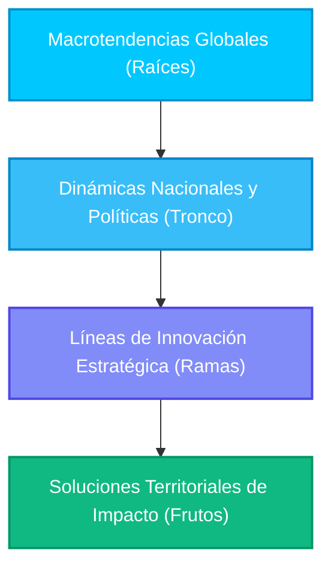
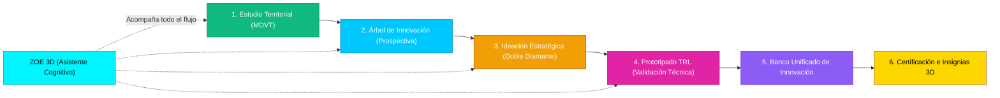
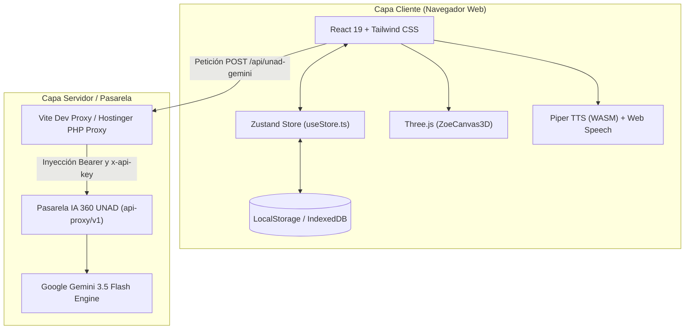

# DOCUMENTO MAESTRO CONSOLIDADO: METODOLOGÍA, SUSTENTO CIENTÍFICO-TEÓRICO, ADAPTACIÓN INSTITUCIONAL A LA UNAD, ARQUITECTURA DE SOFTWARE Y FICHAS TÉCNICAS DEL LABORATORIO DIGITAL DE INNOVACIÓN

**Universidad Nacional Abierta y a Distancia – UNAD**  
**Vicerrectoría de Innovación y Emprendimiento – VIEM**  
**Ecosistema Institucional InnovaHub 360**  
*Documento Técnico, Científico y Arquitectónico Integral*  
*Versión del Sistema: 1.1.1 — Noviembre 2026*  

---

## TABLA DE CONTENIDO
1. **Introducción y Propósito Institucional**
2. **Sección I: Marco Epistémico y Sustento Científico, Teórico y Analítico de la Metodología**
   - 1.1 El Proyecto Académico Pedagógico Solidario (PAPS 3.0) y el Enfoque Territorial
   - 1.2 Metodología de Diagnóstico y Vocación Territorial (MDVT) y Desarrollo Endógeno
   - 1.3 Teoría de Prospectiva Estratégica y Estructuración de Árboles Holográficos
   - 1.4 Modelo de Doble Diamante, Pensamiento de Diseño y Formulación de Retos
   - 1.5 Niveles de Madurez Tecnológica (TRL 1 a 9) y Metodología de Validación Experimental
   - 1.6 Inteligencia Aumentada, Andragogía Dialógica y Andamiaje Cognitivo
3. **Sección II: Comportamiento y Adaptación Institucional en la UNAD**
   - 2.1 Cobertura Multicampus y Despliegue Zonal (ZOCC, ZSUR, ZCAR, ZCORI, ZBOY, ZAMAZ, ZCENTRO, ZCSUR)
   - 2.2 Articulación con la Investigación, Semilleros y Transferencia (VIEM / SIUNAD)
   - 2.3 Modelo Híbrido Resiliente: Operatividad Online/Offline en Regiones Remotas
   - 2.4 Pasarela Institucional de Inteligencia Artificial 360 y Soberanía Tecnológica
4. **Sección III: Análisis Académico y Funcional Detallado de Cada Herramienta Digital**
   - 3.1 Herramienta 1: Estudio y Caracterización Territorial (Eje Territorial)
   - 3.2 Herramienta 2: Árbol Holográfico de Innovación Prospectiva (Eje Tendencias)
   - 3.3 Herramienta 3: Ideación Estratégica y Fórmulas de Reto (Eje Ideación)
   - 3.4 Herramienta 4: Estructuración y Validación de Prototipos TRL (Eje Prototipado)
   - 3.5 Herramienta 5: Banco Unificado de Innovación (Gestión y Transferencia del Conocimiento)
   - 3.6 Herramienta 6: Agente Holográfica de Inteligencia Aumentada ZOE 3D
   - 3.7 Herramienta 7: Sistema de Gamificación 3D y Certificación Institucional de Competencias
5. **Sección IV: Arquitectura Técnica, de Datos, Contenido y Experiencia de Usuario**
   - 4.1 Arquitectura de Software Frontend y Modularidad de Código
   - 4.2 Arquitectura de Datos y Estado Global Reactivo
   - 4.3 Arquitectura de Contenido, Ingeniería de Prompts y Manifiesto Sellado
   - 4.4 Arquitectura de Experiencia de Usuario (UX/UI), Diseño Universal y Accesibilidad
   - 4.5 Seguridad, Privacidad de Datos y Conexión de Servidor
6. **Sección V: Fichas Técnicas de Tecnología por Cada Herramienta Digital**
   - Ficha 1: Diagnóstico y Caracterización Territorial
   - Ficha 2: Árbol Holográfico de Innovación Prospectiva
   - Ficha 3: Ideación Estratégica y Fórmulas de Reto
   - Ficha 4: Estructuración y Validación de Prototipos TRL
   - Ficha 5: Banco Unificado de Innovación
   - Ficha 6: Agente Holográfica ZOE 3D (Audio, Three.js y Síntesis Neuronal)
   - Ficha 7: Gamificación e Impresión de Certificados Criptográficos A4
7. **Conclusiones y Proyección Académica**

---

## 1. INTRODUCCIÓN Y PROPÓSITO INSTITUCIONAL

El **Laboratorio Digital de Innovación** es una plataforma tecnológica e interactiva de última generación concebida por la Universidad Nacional Abierta y a Distancia (UNAD) a través de la Vicerrectoría de Innovación y Emprendimiento (VIEM) en articulación con el Ecosistema InnovaHub 360. Su misión fundamental es democratizar el acceso a metodologías avanzadas de innovación, prospectiva y desarrollo tecnológico en los territorios colombianos, permitiendo que estudiantes, docentes, investigadores, emprendedores y comunidades co-creen soluciones de alto impacto pertinentes a sus realidades regionales.

A diferencia de los entornos de software tradicionales, esta plataforma combina:
1. Un **sustento metodológico riguroso** arraigado en la prospectiva estratégica, el desarrollo endógeno y la maduración tecnológica (TRL).
2. Un motor de **Inteligencia Aumentada Territorial** conectado a los modelos de frontera de la UNAD (`gemini-3.5-flash`), supervisado bajo estrictos guardrails éticos y contextuales.
3. Una interfaz tridimensional inmersiva liderada por **ZOE 3D**, agente pedagógica con síntesis de voz neuronal y visión andragógica.
4. Un sistema de **Acreditación y Gamificación de Competencias** que certifica formalmente las horas de formación y las capacidades desarrolladas según los estándares de la educación superior colombiana.

---

## SECCIÓN I: MARCO EPISTÉMICO Y SUSTENTO CIENTÍFICO, TEÓRICO Y ANALÍTICO

### 1.1 El Proyecto Académico Pedagógico Solidario (PAPS 3.0) y el Enfoque Territorial
El Laboratorio se sustenta directamente sobre el **Proyecto Académico Pedagógico Solidario (PAPS 3.0)** de la UNAD, particularmente en sus componentes ético-político, socio-cultural, comunitario-regional y pedagógico-didáctico.
- **Aprendizaje Autónomo, Significativo y Colaborativo:** La plataforma no concibe al usuario como un receptor pasivo, sino como un agente epistémico activo que interactúa con su contexto local para problematizarlo, conceptualizarlo y transformarlo.
- **Enfoque Territorial y Desarrollo Regional:** Retomando los principios de la investigación-acción-participativa (Fals Borda, 1979) y el desarrollo a escala humana (Max-Neef, 1993), el laboratorio prioriza las vocaciones y necesidades sentidas de las 8 zonas geográficas de la UNAD, evitando soluciones genéricas desarticuladas de la base comunitaria.

### 1.2 Metodología de Diagnóstico y Vocación Territorial (MDVT) y Desarrollo Endógeno
El diagnóstico territorial aplicado en el módulo 1 se fundamenta en las teorías del **desarrollo económico local y endógeno** (Vázquez-Barquero, 2005; Sergio Boisier, 2001) y en el marco de los **Sistemas Regionales de Innovación (SRI)** (Cooke, 1998):
- **Estructura Multidimensional:** El análisis territorial no se limita a variables económicas o de PIB regional; articula de forma holística 6 dimensiones críticas:
  $$\text{Perfil Territorial} = f(\text{Dimensión Social}, \text{Productiva/Económica}, \text{Ambiental}, \text{Institucional}, \text{Infraestructura}, \text{Cultura/Identidad})$$
- **Identificación de Vocaciones Productivas:** Permite pasar del diagnóstico pasivo a la detección de ventajas comparativas dinámicas y oportunidades de agregación de valor en cadenas productivas locales (agroindustria, turismo sostenible, tecnologías de la información, energías renovables, bioeconomía).
- **Modelo de la Casita Territorial:** Representa metafóricamente la estabilidad del ecosistema territorial sobre tres pilares fundacionales: Cimientos (Recursos y Capital Social), Columnas (Capacidades Tecnológicas, Institucionales y Productivas) y Techo (Impacto Social Sostenible y Competitividad Sistémica).

### 1.3 Teoría de Prospectiva Estratégica y Estructuración de Árboles Holográficos
El módulo de tendencias implementa las bases de la **Prospectiva Estratégica y Construcción de Futuros** desarrollada por la escuela francesa (Michel Godet, 1993; Gaston Berger) y consolidada en el contexto latinoamericano por Francisco José Mojica (2005):
- **Árboles de Pertinencia e Innovación:** Se utiliza el árbol holográfico como modelo de descomposición jerárquica y sistémica de la realidad:
  - **Raíces (Macrotendencias Globales):** Factores de cambio global (transformación digital, transición energética, automatización, cambio climático) que ejercen presión sobre el entorno.
  - **Tronco (Dinámicas y Políticas Nacionales):** Normativas, planes de desarrollo (PND), iniciativas de MinCiencias y vectores de transformación en Colombia.
  - **Ramas (Líneas de Innovación Estratégica):** Rutas de aplicación tecnológica y metodológica sectorial.
  - **Frutos (Soluciones Territoriales de Impacto):** Iniciativas concretas, proyectos y tecnologías aplicadas que generan valor en el nodo local.
- **Reducción de Incertidumbre y Anticipación:** Permite a los formuladores de proyectos anticipar rupturas de mercado y tecnológicas, asegurando que las soluciones planteadas mantengan vigencia durante los próximos 5 a 10 años.

### 1.4 Modelo de Doble Diamante, Pensamiento de Diseño y Formulación de Retos
La transición del diagnóstico a la solución se rige por el modelo del **Doble Diamante del Design Council de Londres** (2005) y la metodología de **Design Thinking** (Brown, 2008):
- **Fase Divergente 1 (Descubrir):** Exploración abierta de tensiones territoriales y problemáticas sentidas.
- **Fase Convergente 1 (Definir):** Delimitación precisa del reto mediante la fórmula canónica de estructuración de retos:
  $$\text{Reto Formal} = \text{Verbo de Acción} + \text{Sujeto / Comunidad Objetivo} + \text{Contexto / Restricción Territorial} + \text{Impacto / Propósito Transformador}$$
- **Fase Divergente 2 (Desarrollar):** Generación multifacética de alternativas de solución combinando componentes tecnológicos, sociales y organizacionales.
- **Fase Convergente 2 (Entregar):** Selección cuantitativa y cualitativa de la alternativa estratégica con mayor viabilidad técnica, deseabilidad comunitaria y sostenibilidad financiera.

### 1.5 Niveles de Madurez Tecnológica (TRL 1 a 9) y Metodología de Validación Experimental
El módulo de prototipado adopta formalmente el estándar de **Technology Readiness Levels (TRL)** concebido originariamente por la NASA (Mankins, 1995) y normado en Colombia por el Ministerio de Ciencia, Tecnología e Innovación (MinCiencias):
- **Estructuración TRL en el Laboratorio:**
  - *TRL 1-2 (Fase Conceptual):* Principios básicos observados y concepto tecnológico formulado.
  - *TRL 3-4 (Prueba de Concepto y Validación en Laboratorio):* Prototipo alfa a escala mínima, analítica de datos y ensayos controlados.
  - *TRL 5-6 (Validación en Entorno Relevante/Simulado):* Prototipo beta operativo probado en condiciones territoriales representativas.
  - *TRL 7-9 (Despliegue y Madurez Operativa):* Prototipo final, validación en entorno real y transferencia al mercado o comunidad.
- **Protocolo de Validación Experimental:** Cada prototipo estructurado en el sistema debe definir obligatoriamente:
  1. *Hipótesis Crítica de Validación (H0 / H1).*
  2. *Arquitectura Funcional y Técnica de la Solución.*
  3. *Cronograma por Fases de Iteración (Sprint / Hitos).*
  4. *Métricas Clave de Rendimiento (KPIs) y Criterios de Aceptación.*
  5. *Matriz de Riesgos Tecnológicos y Planes de Mitigación.*

### 1.6 Inteligencia Aumentada, Andragogía Dialógica y Andamiaje Cognitivo
La interacción con la agente **ZOE 3D** no responde a un esquema de chatbot comercial de preguntas y respuestas, sino a un modelo de **Inteligencia Aumentada para la Educación Superior (Human-in-the-Loop)**:
- **Andamiaje Cognitivo (Scaffolding):** Basado en Jerome Bruner (1976) y la Zona de Desarrollo Próximo (ZDP) de Lev Vygotsky (1978). ZOE acompaña al usuario guiándolo paso a paso, proporcionando retroalimentación socrática y orientando la toma de decisiones sin sustituir el juicio crítico del investigador humano.
- **Andragogía Dialógica (Malcolm Knowles, 1984):** Orientada a adultos y jóvenes con autonomía de aprendizaje, valorando la experiencia previa del usuario en su territorio e impulsando la aplicación práctica e inmediata de los conocimientos adquiridos.

---

## SECCIÓN II: COMPORTAMIENTO Y ADAPTACIÓN INSTITUCIONAL EN LA UNAD

### 2.1 Cobertura Multicampus y Despliegue Zonal
La UNAD opera bajo un modelo de educación a distancia descentralizado que cubre todo el territorio nacional e internacional. El Laboratorio Digital de Innovación está adaptado nativamente para atender la diversidad de las **8 Zonas Institucionales**:
1. **Zona Amazonia - Orinoquia (ZAMAZ / ZOR):** Foco en bioeconomía, preservación de ecosistemas, soberanía alimentaria y logística fluvial.
2. **Zona Caribe (ZCAR):** Agroindustria costera, energías solar/eólica, logística portuaria y turismo patrimonial.
3. **Zona Centro Bogotá - Cundinamarca (ZCBC):** Industria 4.0, fintech, ciudades inteligentes y servicios de base tecnológica.
4. **Zona Centro Boyacá (ZBOY):** Minería sostenible, producción agropecuaria de clima frío, patrimonio y artesanía digital.
5. **Zona Centro Oriente (ZCORI):** Ecosistemas de frontera, producción cafetera, cacaotera y biotecnología aplicada.
6. **Zona Centro Sur (ZCSUR):** Agroecología, economía circular, cadenas de valor de café especial y gobernanza comunitaria.
7. **Zona Occidente (ZOCC):** Cadena de suministros, manufactura avanzada, clústeres agrícolas y biomedicina.
8. **Zona Sur (ZSUR):** Biodiversidad andino-amazónica, resolución de conflictos territoriales y ecoturismo.

El sistema permite vincular cualquier ejercicio a los más de 70 centros de la UNAD (**CEAD, CCAV, CERES, UDR**), identificando el nodo territorial exacto de generación de la innovación.

### 2.2 Articulación con la Investigación, Semilleros y Transferencia (VIEM / SIUNAD)
El Laboratorio actúa como el **eslabón articulador entre el aula, el semillero de investigación y la transferencia productiva**:
- **Alimentación del Banco de Proyectos VIEM:** Los ejercicios estructurados en el Laboratorio quedan catalogados con identificación de equipo, zona y TRL, listos para postularse a convocatorias internas de semilleros o convocatorias de MinCiencias.
- **Exportación Institucional:** Generación automática de informes técnicos en formatos editables (`.docx` Word institucional y `.pdf` formal) estructurados con normas APA y fichas metodológicas homologadas por la Vicerrectoría de Innovación y Emprendimiento.

### 2.3 Modelo Híbrido Resiliente: Operatividad Online/Offline en Regiones Remotas
Consciente de la brecha de conectividad en la ruralidad colombiana, el Laboratorio incorpora una arquitectura de **alta resiliencia territorial**:
- **Almacenamiento Local Reactivo:** Todos los datos, avances y estados de los módulos se preservan instantáneamente en el almacenamiento del navegador (`LocalStorage` / `IndexedDB`), impidiendo la pérdida de información ante cortes imprevistos de fluido eléctrico o internet.
- **Cerebro Offline de ZOE:** Si la red se interrumpe, ZOE pasa inmediatamente al modo *Offline Resiliente*, utilizando su base de conocimiento local para responder dudas metodológicas, guiar las etapas del taller y permitir la redacción y consolidación de fichas sin depender de servidores externos.
- **Compilación Estática Ligera:** La aplicación se sirve con empaquetamiento optimizado y rutas relativas (`base: './'`), permitiendo ejecutarse tanto en servidores web en la nube como en servidores locales comunitarios o memorias USB sin acceso a internet.

### 2.4 Pasarela Institucional de Inteligencia Artificial 360 y Soberanía Tecnológica
- **Proxy Inverso Seguro (`/api/unad-gemini`):** Las consultas de IA se enrutan a través del proxy oficial de la UNAD (`https://chatbot-ia-360.unad.edu.co/api-proxy/v1`).
- **Protección de Datos Institucionales:** Las credenciales maestras residen exclusivamente del lado del servidor; el navegador cliente nunca tiene acceso a claves secretas ni tokens de infraestructura, cumpliendo los lineamientos de la Ley 1581 de Protección de Datos Personales de Colombia.

---

## SECCIÓN III: ANÁLISIS ACADÉMICO Y FUNCIONAL DE CADA HERRAMIENTA DIGITAL

### 3.1 Herramienta 1: Estudio y Caracterización Territorial (Eje Territorial)
- **Propósito Académico:** Analizar sistemáticamente la realidad biofísica, sociocultural, institucional y económica de una microrregión o municipio colombiano para fundamentar intervenciones de innovación con base empírica y territorial.
- **Funcionalidades Principales:**
  1. *Ficha de Identidad Territorial:* Selección de Departamento, Municipio, Entorno (Urbano, Rural, Periurbano, Resguardo, Cuenca) y Zona UNAD.
  2. *Diagnóstico Multidimensional:* Evaluación guiada de los 6 ejes del MDVT (Social, Productivo, Ambiental, Institucional, Tecnológico, Cultural).
  3. *Matriz de Oportunidades y Vocaciones:* Cruce de recursos endógenos frente a demandas insatisfechas para identificar focos de oportunidad.
  4. *Generación Asistida por IA Territorial:* Estructuración de síntesis diagnóstica en prosa académica con citas de contexto territorial y fuentes institucionales (DANE, DNP, Terridata).
  5. *Exportación Formal:* Generación instantánea de informe técnico en Word (`.docx`) y vista de impresión formal.

### 3.2 Herramienta 2: Árbol Holográfico de Innovación Prospectiva (Eje Tendencias)
- **Propósito Académico:** Mapear la convergencia entre macrotendencias globales de frontera y las capacidades productivas regionales, aplicando la teoría de prospectiva estratégica para derivar frutos tecnológicos pertinentes.
- **Funcionalidades Principales:**
  1. *Estructuración Jerárquica del Árbol:*
     - *Raíces:* Macrotendencias globales (Inteligencia Artificial, Bioeconomía, Computación Cuántica, Materiales Avanzados, Robótica, Transición Climática).
     - *Tronco:* Políticas de desarrollo regional, CONPES vigentes y líneas estratégicas del PND.
     - *Ramas:* Líneas de acción tecnológico-productivas adaptadas a la región.
     - *Frutos:* Proyectos concretos de innovación y desarrollos de alto valor agregado.
  2. *Lienzo Visual Interactivo:* Renderizado SVG dinámico con diagramación jerárquica, nodos expandibles, inspectores contextuales y codificación cromática por nivel.
  3. *Generador Prospectivo con IA:* Co-creación de árboles a partir de un sector productivo y una región específica, garantizando coherencia sistémica desde la raíz hasta el fruto.
  4. *Exportación Gráfica y Documental:* Descarga del diagrama en vector SVG de alta resolución y reporte técnico detallado.

### 3.3 Herramienta 3: Ideación Estratégica y Fórmulas de Reto (Eje Ideación)
- **Propósito Académico:** Convertir los dolores y oportunidades diagnosticados en retos formalmente estructurados, aplicando técnicas de divergencia creativa y matrices multicriterio de selección para elegir la alternativa de mayor potencial.
- **Funcionalidades Principales:**
  1. *Generador Canónico de Fórmulas de Reto:* Constructor interactivo que fuerza la estructura metodológica rigurosa (`¿Cómo podríamos [Acción] para [Comunidad] en [Contexto] logrando [Impacto]?`).
  2. *Matriz de Ideación Divergente:* Generación de abanicos de alternativas (soluciones basadas en tecnología digital, innovaciones de base comunitaria, economía circular y modelos de servicio).
  3. *Filtro Multicriterio de Selección (Convergencia):* Evaluación cuantitativa en escala Likert (1 a 5) ponderando 4 dimensiones esenciales:
     $$Puntaje = 0.30 \cdot \text{Factibilidad Técnica} + 0.30 \cdot \text{Impacto Social} + 0.20 \cdot \text{Deseabilidad} + 0.20 \cdot \text{Viabilidad Financiera}$$
  4. *Ficha Conceptual de la Solución Ganadora:* Descripción ejecutiva, propuesta de valor, beneficiarios directos e indirectos y factores de innovación.

### 3.4 Herramienta 4: Estructuración y Validación de Prototipos TRL (Eje Prototipado)
- **Propósito Académico:** Planificar la materialización técnica de la idea ganadora mediante un plan de prototipado iterativo y experimental, definiendo la escala de madurez tecnológica inicial y la meta esperada.
- **Funcionalidades Principales:**
  1. *Calibración TRL Inicial vs. TRL Objetivo:* Clasificación guiada del nivel de madurez tecnológica según la escala de 9 niveles de MinCiencias.
  2. *Diseño Experimental y Formulación de Hipótesis:* Planteamiento de la hipótesis crítica de falla técnica o de mercado que el prototipo debe someter a prueba.
  3. *Arquitectura de la Solución Técnica:* Desglose de componentes de hardware, software, procesos operativos y requerimientos de infraestructura local.
  4. *Plan de Fases de Validación:* Cronograma por sprints (Fase Alfa, Beta, Piloto en Campo) con definición de insumos, responsables y criterios de éxito.
  5. *Matriz de Riesgos y Mitigación:* Identificación preventiva de cuellos de botella tecnológicos, regulatorios, ambientales y comunitarios.

### 3.5 Herramienta 5: Banco Unificado de Innovación (Gestión y Transferencia del Conocimiento)
- **Propósito Académico:** Gestionar el ciclo de vida del conocimiento generado en los talleres, actuando como repositorio institucional descentralizado que garantiza la memoria histórica y la trazabilidad de la innovación unadista.
- **Funcionalidades Principales:**
  1. *Persistencia Reactiva y Segura:* Almacenamiento local automático de todos los ejercicios finalizados en el navegador.
  2. *Filtrado Avanzado y Búsqueda:* Filtrado multidimensional por herramienta, zona territorial, fecha y palabras clave.
  3. *Interoperabilidad de Datos (Importación / Exportación JSON):* Capacidad de descargar el banco completo en un archivo JSON estructurado para transferirlo entre equipos o restaurar copias de respaldo.
  4. *Generador Multiformato de Entregables:* Descarga individual de cada ejercicio en Word editable formal (`.docx`), documento para impresión (`PDF`), o eliminación selectiva.
  5. *Acceso a Gamificación:* Puente de navegación directo hacia la galería de insignias 3D y la emisión de diplomas de acreditación.

### 3.6 Herramienta 6: Agente Holográfica de Inteligencia Aumentada ZOE 3D
- **Propósito Académico:** Ofrecer acompañamiento pedagógico andragógico continuo mediante un entorno interactivo en 3D que integra lenguaje natural, visión de contexto y síntesis de voz en tiempo real.
- **Funcionalidades Principales:**
  1. *Visor Tridimensional Inmersivo (Three.js):* Renderizado en tiempo real del avatar holográfico de ZOE con animaciones contextuales sincronizadas (saludo, pensamiento, escucha activa, celebración de hitos, explicación metodológica).
  2. *Motor de Síntesis de Voz Neuronal (Piper TTS + WebAssembly):* Capacidad de locución hablada en español neutro de alta fidelidad, ejecutada directamente en el navegador del usuario sin latencia de red.
  3. *Reconocimiento de Voz por Micrófono (Web Speech API):* Diálogo bidireccional hablado y subtitulado en tiempo real.
  4. *Consciencia Contextual del Laboratorio:* ZOE conoce en todo momento en qué herramienta se encuentra el usuario, qué campos ha diligenciado y cuál es el siguiente paso metodológico recomendado.
  5. *Cerebro Resiliente Offline:* Módulo de contingencia con más de 50 preguntas frecuentes y reglas metodológicas locales que garantizan la conversación aun si la pasarela de IA está fuera de línea.

### 3.7 Herramienta 7: Sistema de Gamificación 3D y Certificación Institucional de Competencias
- **Propósito Académico:** Reconocer, validar y certificar formalmente las competencias de innovación desarrolladas por los estudiantes y participantes a lo largo del proceso formativo, integrando microcredenciales digitales y diplomas institucionales acreditables.
- **Funcionalidades Principales:**
  1. *Colección de 7 Insignias Tridimensionales Calibradas:*
     - Cada insignia cuenta con su diseño en relieve 3D, emblema heráldico y la paleta cromática oficial de su unidad:
       - **Pionero Territorial:** `#10B981` (Verde esmeralda territorial) — 24 horas acreditadas.
       - **Visionario Estratégico:** `#F29F05` (Ámbar cálido de ideación) — 24 horas acreditadas.
       - **Arquitecto de Tendencias:** `#00C8FF` (Azul celeste prospectivo) — 30 horas acreditadas.
       - **Ingeniero de Prototipos:** `#E024A5` (Fucsia prototipado) — 36 horas acreditadas.
       - **Custodio del Conocimiento:** `#A78BFA` (Púrpura banco unificado) — 20 horas acreditadas.
       - **Vínculo Cognitivo:** `#00F5FF` (Cian digital ZOE) — 18 horas acreditadas.
       - **Maestro Innovador 360:** `#FFD700` (Oro imperial) — 120 horas acreditadas (articulación integral de los 4 ejes).
  2. *Generador de Certificados Oficiales A4 Apaisados:*
     - Documento de alta fidelidad estética y tipográfica concebido para impresión o guardado directo en PDF vectorial (`@media print` calibrado a 297mm x 210mm).
     - Incorpora la identidad visual oficial: logotipo de **InnovaHub 360**, escudo y emblema de la **Universidad Nacional Abierta y a Distancia (UNAD)** y de la **Vicerrectoría de Innovación y Emprendimiento (VIEM)**.
     - Personalización completa: Nombre del estudiante o investigador, documento de identidad (C.C.), equipo innovador, fecha de emisión y resumen formal de competencias adquiridas.
     - Código QR institucional y código criptográfico de verificación para garantizar la autenticidad del documento.

---

## SECCIÓN IV: ARQUITECTURA TÉCNICA, DE DATOS, CONTENIDO Y EXPERIENCIA

### 4.1 Arquitectura de Software Frontend y Modularidad de Código
El sistema está construido siguiendo los estándares contemporáneos de desarrollo de aplicaciones web de alto rendimiento:
- **Framework Principal:** React 19 con TypeScript en modo estricto (`strict: true`), garantizando tipado estático total y ausencia de errores de tiempo de ejecución.
- **Herramienta de Construcción:** Vite 6 optimizado con división de código dinámica (*dynamic imports* y *code-splitting*) para aislar módulos pesados (Three.js, exportadores Word/PDF y WebAssembly).
- **Estilos y Diseño:** Tailwind CSS con tokens de diseño unificados en [src/index.css](file:///c:/Users/57304/Desktop/LABORATORIO%20DE%20INNOVACON/laboratorio-digital-innovacion/src/index.css), garantizando coherencia visual en modo claro y oscuro.
- **Desacoplamiento Modular:** Separación estricta entre:
  - *Componentes de Presentación:* `src/components/tools/`, `src/components/layout/`, `src/components/gamification/`.
  - *Servicios de Datos y Lógica de Negocio:* `src/services/`.
  - *Gestión de Estado Centralizado:* `src/store/`.
  - *Librerías de Utilidad y Exportación:* `src/lib/`.

### 4.2 Arquitectura de Datos y Estado Global Reactivo
- **Almacenamiento Centralizado (`useStore.ts`):** Basado en Zustand con almacenamiento sincrónico persistente. Controla las colecciones completas del sistema:
  - `territorialDraft` y `territorialSaved`: Datos de la caracterización multidimensional.
  - `ideationDraft` y `ideationSaved`: Fórmulas de reto, alternativas y selección ganadora.
  - `treeDraft` y `treeSaved`: Estructura arbórea de nodos prospectivos.
  - `prototypeDraft` y `prototypeSaved`: Plan TRL, fases y métricas de validación.
  - `bancoItems`: Matriz de ejercicios catalogados en el Banco Unificado.
  - `unlockedBadges`: Estado y marcas de tiempo de las insignias obtenidas.
- **Auto-guardado Automático (`bancoAutomatico.ts`):** Cada vez que un usuario finaliza con éxito la generación de un entregable en cualquiera de las 4 herramientas, un observador reactivo registra automáticamente el ejercicio en el Banco Unificado con un identificador único (UUIDv4) y marca de tiempo ISO 8601, emitiendo una notificación de guardado y desbloqueando la insignia correspondiente.

### 4.3 Arquitectura de Contenido, Ingeniería de Prompts y Manifiesto Sellado
- **Ingeniería de Prompts Contextualizada:** Los prompts alojados en `src/prompts/` (ej. `contenedor2Sections.ts`, `themeAndInnovationPrompts.ts`, `labGuardrails.ts`) no son plantillas fijas, sino funciones generativas que ensamblan:
  1. *El Rol y Tono Institucional:* Investigador y asesor metodológico senior de la UNAD.
  2. *El Contexto Territorial Inyectado:* Datos geográficos, vocaciones productivas y dimensiones diagnosticadas previamente por el usuario.
  3. *Los Guardrails Éticos:* Prohibición absoluta de alucinación de normativas, exclusión de terminología obsoleta y exigencia de viabilidad técnica realista.
  4. *Estructura de Salida JSON / Markdown Estricto:* Garantiza que la respuesta pueda ser parseada programáticamente y renderizada en componentes interactivos sin fallos de formato.
- **Sellado Criptográfico del Repositorio:** El sistema cuenta con un script de precompilación (`scripts/sellar-repositorio.mjs`) que calcula el hash SHA-256 de todas las fuentes de consulta institucionales en `public/REPOSITORIO_CIP_DF/manifest.json`, garantizando la integridad referencial y trazabilidad del contenido.

### 4.4 Arquitectura de Experiencia de Usuario (UX/UI), Diseño Universal y Accesibilidad
- **Diseño Adaptativo Universal (Responsive 360):** La interfaz responde con fluidez desde estaciones de trabajo de escritorio con pantallas panorámicas hasta computadores portátiles institucionales y dispositivos móviles de campo.
- **Paleta Cromática Institucional de Alto Contraste:**
  - *Modo Oscuro Inmersivo:* Fondos pizarra profundos (`#0A0F1D`, `#111827`) con acentos luminosos en cian, ámbar y fucsia que reducen la fatiga visual en sesiones prolongadas de ideación.
  - *Modo Claro Institucional:* Fondos nítidos con contrastes tipográficos que cumplen los estándares WCAG 2.1 nivel AA.
- **Accesibilidad Multimodal:** Soporte para interacción por teclado, lectores de pantalla con etiquetas ARIA semánticas y duplicación de información visual mediante síntesis de voz hablada por ZOE.

### 4.5 Seguridad, Privacidad de Datos y Conexión de Servidor
- **Aislamiento de Secretos:** Las claves de acceso a los servicios de IA residen exclusivamente en variables de entorno de servidor (`.env.local` en desarrollo, `gemini_proxy.php` en despliegue PHP Hostinger). Ninguna clave privada o credencial de la UNAD se compila en los archivos JavaScript públicos.
- **Seguridad en Navegador:** Operación completa bajo protocolo HTTPS forzado, encabezados CSP (*Content Security Policy*) y almacenamiento seguro en espacios de origen aislado (*Same-Origin Policy*).

---

## SECCIÓN V: FICHAS TÉCNICAS DE TECNOLOGÍA POR HERRAMIENTA DIGITAL

### FICHA TÉCNICA 1: DIAGNÓSTICO Y CARACTERIZACIÓN TERRITORIAL
| Parámetro | Especificación Técnica |
| :--- | :--- |
| **Identificador Técnico** | `tool_estudio_territorial` |
| **Componente de Entrada** | [EstudioTerritorialView.tsx](file:///c:/Users/57304/Desktop/LABORATORIO%20DE%20INNOVACON/laboratorio-digital-innovacion/src/components/tools/EstudioTerritorialView.tsx) |
| **Servicio de Negocio** | [territorialStudy.ts](file:///c:/Users/57304/Desktop/LABORATORIO%20DE%20INNOVACON/laboratorio-digital-innovacion/src/services/territorialStudy.ts) |
| **Entradas del Usuario** | Departamento, municipio, entorno geográfico, descripción comunitaria, variables del MDVT. |
| **Motor de Procesamiento** | Pipeline de generación analítica con inyección de contexto DANE/DNP vía `unadGeminiProxy`. |
| **Estructura de Salida** | JSON normalizado con matriz de 6 dimensiones, síntesis diagnóstica formal y oportunidades priorizadas. |
| **Exportadores Soportados** | Word institucional (`.docx`), vista de impresión formal (`PDF`), persistencia en Banco Unificado. |
| **Insignia Asociada** | *Pionero Territorial* (ID: `pionero_territorial`, Color: `#10B981`, Acreditación: 24 horas). |

---

### FICHA TÉCNICA 2: ÁRBOL HOLOGRÁFICO DE INNOVACIÓN PROSPECTIVA
| Parámetro | Especificación Técnica |
| :--- | :--- |
| **Identificador Técnico** | `tool_arbol_innovacion` |
| **Componente de Entrada** | [ArbolInnovacionView.tsx](file:///c:/Users/57304/Desktop/LABORATORIO%20DE%20INNOVACON/laboratorio-digital-innovacion/src/components/tools/ArbolInnovacionView.tsx) |
| **Librerías de Renderizado** | [innovationTreeGraph.ts](file:///c:/Users/57304/Desktop/LABORATORIO%20DE%20INNOVACON/laboratorio-digital-innovacion/src/lib/innovationTreeGraph.ts), [innovationTreeSvg.ts](file:///c:/Users/57304/Desktop/LABORATORIO%20DE%20INNOVACON/laboratorio-digital-innovacion/src/lib/innovationTreeSvg.ts) (Lienzo interactivo SVG vectorial). |
| **Servicio de Negocio** | [innovationTree.ts](file:///c:/Users/57304/Desktop/LABORATORIO%20DE%20INNOVACON/laboratorio-digital-innovacion/src/services/innovationTree.ts) |
| **Estructura del Grafo** | Estructura de árbol con 4 capas jerárquicas: Raíces (Macro), Tronco (Meso), Ramas (Micro), Frutos (Impacto). |
| **Interacciones de UI** | Expansión/colapso de ramas, zoom panorámico, selección de nodo con panel lateral de detalles. |
| **Formatos de Exportación** | Gráfico vectorial SVG descargable y reporte narrativo de prospectiva en Word/PDF. |
| **Insignia Asociada** | *Arquitecto de Tendencias* (ID: `arquitecto_tendencias`, Color: `#00C8FF`, Acreditación: 30 horas). |

---

### FICHA TÉCNICA 3: IDEACIÓN ESTRATÉGICA Y FÓRMULAS DE RETO
| Parámetro | Especificación Técnica |
| :--- | :--- |
| **Identificador Técnico** | `tool_ideacion_estrategica` |
| **Componente de Entrada** | [IdeacionEstrategicaView.tsx](file:///c:/Users/57304/Desktop/LABORATORIO%20DE%20INNOVACON/laboratorio-digital-innovacion/src/components/tools/IdeacionEstrategicaView.tsx) |
| **Servicio de Negocio** | [ideation.ts](file:///c:/Users/57304/Desktop/LABORATORIO%20DE%20INNOVACON/laboratorio-digital-innovacion/src/services/ideation.ts) |
| **Algoritmo de Priorización** | Función de ponderación lineal multicriterio sobre 4 factores (Factibilidad, Impacto, Deseabilidad, Viabilidad). |
| **Entradas del Usuario** | Hipótesis de reto, comunidad beneficiaria, restricciones territoriales, criterios de evaluación. |
| **Salida Estructurada** | Reto canónico validado, abanico de alternativas analizadas y ficha técnica de la idea ganadora. |
| **Insignia Asociada** | *Visionario Estratégico* (ID: `visionario_estrategico`, Color: `#F29F05`, Acreditación: 24 horas). |

---

### FICHA TÉCNICA 4: ESTRUCTURACIÓN Y VALIDACIÓN DE PROTOTIPOS TRL
| Parámetro | Especificación Técnica |
| :--- | :--- |
| **Identificador Técnico** | `tool_prototipado_trl` |
| **Componente de Entrada** | [PrototipadoView.tsx](file:///c:/Users/57304/Desktop/LABORATORIO%20DE%20INNOVACON/laboratorio-digital-innovacion/src/components/tools/PrototipadoView.tsx) |
| **Servicio de Negocio** | [prototyping.ts](file:///c:/Users/57304/Desktop/LABORATORIO%20DE%20INNOVACON/laboratorio-digital-innovacion/src/services/prototyping.ts) |
| **Escala Metodológica** | Escala de madurez tecnológica TRL 1 a TRL 9 (MinCiencias Colombia / NASA). |
| **Módulos de Planificación** | Formulación de hipótesis crítica, arquitectura modular de solución, fases de validación, matriz de riesgos. |
| **Entregables** | Ficha de prototipado formal editable en `.docx` y persistida en el repositorio territorial. |
| **Insignia Asociada** | *Ingeniero de Prototipos* (ID: `ingeniero_prototipos`, Color: `#E024A5`, Acreditación: 36 horas). |

---

### FICHA TÉCNICA 5: BANCO UNIFICADO DE INNOVACIÓN
| Parámetro | Especificación Técnica |
| :--- | :--- |
| **Identificador Técnico** | `tool_banco_innovacion` |
| **Componente de Entrada** | [BancoInnovacionView.tsx](file:///c:/Users/57304/Desktop/LABORATORIO%20DE%20INNOVACON/laboratorio-digital-innovacion/src/components/tools/BancoInnovacionView.tsx) |
| **Manejador de Persistencia** | [bancoAutomatico.ts](file:///c:/Users/57304/Desktop/LABORATORIO%20DE%20INNOVACON/laboratorio-digital-innovacion/src/store/bancoAutomatico.ts) y `useStore.ts` |
| **Mecanismo de Guardado** | Reactivo asíncrono con serialización JSON en LocalStorage e IndexedDB. |
| **Capacidades Operativas** | Búsqueda por texto libre, filtrado por herramienta, exportación global e importación de respaldo JSON. |
| **Exportadores Unitarios** | Descarga bajo demanda en Microsoft Word formal (`.docx`) y vista de impresión (`PDF`). |
| **Insignia Asociada** | *Custodio del Conocimiento* (ID: `custodio_conocimiento`, Color: `#A78BFA`, Acreditación: 20 horas). |

---

### FICHA TÉCNICA 6: AGENTE HOLOGRÁFICA DE INTELIGENCIA AUMENTADA ZOE 3D
| Parámetro | Especificación Técnica |
| :--- | :--- |
| **Identificador Técnico** | `agent_zoe_3d` |
| **Motor de Renderizado 3D** | Three.js (WebGL) sobre lienzo Canvas HTML5 ([ZoeCanvas3D.tsx](file:///c:/Users/57304/Desktop/LABORATORIO%20DE%20INNOVACON/laboratorio-digital-innovacion/src/components/zoe/ZoeCanvas3D.tsx)). |
| **Modelo Tridimensional** | Archivo GLB optimizado con malla poligonal ligera y esqueletos de animación ósea (`zoe.glb`). |
| **Síntesis de Voz (TTS)** | Piper TTS Web ejecutado vía WebAssembly (`ort.wasm` + `@mintplex-labs/piper-tts-web`). |
| **Entrada de Voz** | Web Speech Recognition API nativa con transcripción continua en pantalla. |
| **Cerebro Inteligente** | Híbrido: `unadGeminiProxy` (online con `gemini-3.5-flash`) y [zoeOffline.ts](file:///c:/Users/57304/Desktop/LABORATORIO%20DE%20INNOVACON/laboratorio-digital-innovacion/src/lib/zoeOffline.ts) (offline resiliente). |
| **Insignia Asociada** | *Vínculo Cognitivo* (ID: `vinculo_cognitivo`, Color: `#00F5FF`, Acreditación: 18 horas). |

---

### FICHA TÉCNICA 7: GAMIFICACIÓN Y DIPLOMAS INSTITUCIONALES CRIPTOGRÁFICOS
| Parámetro | Especificación Técnica |
| :--- | :--- |
| **Identificador Técnico** | `system_gamification_certificates` |
| **Componentes de Interfaz** | [BadgeGraphics.tsx](file:///c:/Users/57304/Desktop/LABORATORIO%20DE%20INNOVACON/laboratorio-digital-innovacion/src/components/gamification/BadgeGraphics.tsx), [BadgesModal.tsx](file:///c:/Users/57304/Desktop/LABORATORIO%20DE%20INNOVACON/laboratorio-digital-innovacion/src/components/gamification/BadgesModal.tsx), [BadgeNotification.tsx](file:///c:/Users/57304/Desktop/LABORATORIO%20DE%20INNOVACON/laboratorio-digital-innovacion/src/components/gamification/BadgeNotification.tsx) |
| **Generador de Certificados** | [certificatePdfExport.ts](file:///c:/Users/57304/Desktop/LABORATORIO%20DE%20INNOVACON/laboratorio-digital-innovacion/src/lib/certificatePdfExport.ts) |
| **Formato del Diploma** | Documento imprimible A4 Paisaje (`297mm x 210mm`) con tipografía institucional y orlas heráldicas. |
| **Logotipos Integrados** | Isotipo y logotipo oficial de **InnovaHub 360**, sello oficial de la **UNAD** y emblema de la **VIEM**. |
| **Seguridad y Trazabilidad** | Código QR de verificación institucional y resumen canónico de competencias y horas de formación. |
| **Insignia Suprema** | *Maestro Innovador 360* (ID: `maestro_innovador_360`, Color: `#FFD700`, Acreditación: 120 horas integradas). |

---

## 7. CONCLUSIONES Y PROYECCIÓN ACADÉMICA

El **Laboratorio Digital de Innovación** de la Universidad Nacional Abierta y a Distancia constituye una solución tecnológica pionera en el sistema de educación superior de América Latina. Al entrelazar un marco teórico sólido (desarrollo endógeno, prospectiva estratégica, pensamiento de diseño y maduración tecnológica TRL) con una arquitectura de software abierta, reactiva y resiliente a la brecha de conectividad territorial, la plataforma logra:

1. **Transformar la Investigación Formativa:** Convierte ejercicios abstractos en proyectos estructurados listos para ser validados en campo con comunidades y sectores productivos.
2. **Promover la Equidad Territorial:** Permite que estudiantes y docentes desde cualquier Centro o Nodo rural tengan exactamente las mismas herramientas y capacidades de prospectiva e innovación que los grandes centros urbanos.
3. **Garantizar la Memoria Institucional:** A través del Banco Unificado de Innovación, la UNAD preserva y transfiere el capital intelectual acumulado en sus regiones, fortaleciendo el impacto social transformador que caracteriza el modelo unadista.
